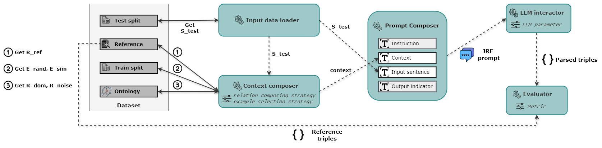

# ContextEval4RE

This repository contains the source code, datasets, prompts, LLM outputs, and evaluation results for our paper: 

**From Prompt to Context: Analyzing Context Engineering Effectiveness for LLM-based Knowledge Graph Construction**  

---

## Contents

- [Repository Overview](#repository-overview)
- [Directory Structure](#directory-structure)
- [Quick Start](#quick-start)
- [License](#license)

---

## Repository Overview


This repo supports:
- Loading multiple datasets with train/test splits and ontologies
- Composing context (relation selection + example selection)
- Composing prompts (instruction, context, input sentence, output indicator)
- Interacting with LLMs (API or local deployment, depending on your setup)
- Evaluating extracted triples with standard metrics
- (Optional) Attention analysis on model outputs

---
## Directory Structure

High-level structure after unzipping:

```text
.
├── attention_analysis_results/
│   ├── attention_analysis_results/
│   └── attention_raw_results/
├── datasets/
│   ├── dbpedia_webnlg/
│   │   ├── examples_random/
│   │   ├── ground_truth/
│   │   ├── ontologies/
│   │   │   └── owl/
│   │   ├── test/
│   │   ├── test_ground_truth_relations/
│   │   ├── test_train_sent_similarity/
│   │   └── train/
│   ├── webnlg/              # same structure as dbpedia_webnlg/
│   └── wikidata_tekgen/      # same structure as dbpedia_webnlg/
├── docs/
├── evaluation_results/
├── eval_results/
├── llm_outputs/
├── prompts/
└── src/
    ├── attention_analysis/
    ├── context-composer/
    │   ├── example-selector/
    │   └── relation-selector/
    ├── dataset-preprocessor/
    ├── evaluator/
    ├── llm-interactor/
    └── prompt-composer/

```

Folder notes:

`datasets/`: processed dataset splits, ontologies, ground truth, and helper files.

`prompts/`: saved prompts used in experiments.

`llm_outputs/`: raw model outputs grouped by dataset/model/shot/setting.

`eval_results/`: evaluation results grouped by dataset/model/shot/setting; includes global_eval/ summaries.

`evaluation_results/`: summaries of evaluation results in `csv` format.

`attention_analysis/`: optional analysis outputs (raw attention + aggregated results).

`src/`: implementation of the framework modules shown in the framework figure.

## Quick Start

### 0) unzip the file
Unzip the provided zip file **to the repository root** (the same folder as `README.md`).

After extraction, you should see folders as shown in the Directory Structure

### 1) Environment setup

We recommend using **conda**:

```bash
conda create -n llm4kgc python=3.10
conda activate llm4kgc
pip install -r requirements.txt
```

### 2) Reproducing Experiments

#### Run the 16 prompt variations (paper settings) and evaluate

1) **Run API-based models (DeepSeek-V3 / GPT-4.1-nano)**  
Edit the `root folder path`, and select the `dataset` and `prompt_folder_name` in:
- `src/llm-interactor/run_ds.py` (DeepSeek-V3)
- `src/llm-interactor/run_gpt.py` (GPT-4.1-nano)

Run:
```bash
python ./src/llm-interactor/run_ds.py
```
or
```bash
python ./src/llm-interactor/run_gpt.py
```
2) **Run locally deployed small/medium models**
Edit the `root folder path`, and select the `model_name`, `dataset`, and `prompt_folder_name` in:

- `src/llm-interactor/run_local_llm.py` 

Run: 
```bash
python ./src/llm-interactor/run_local_llm.py
```
Expected outputs (raw LLM responses) will be saved under: `llm_outputs/` 


3) **Evaluate (same evaluation script as in the paper)**  
Make sure the folder structure matches the unzipped artifact. Then run (example: webnlg + gpt-4.1-nano + 1shot):
```bash
python src\evaluator\eval_robust.py --dataset webnlg --model gpt-4.1-nano --shot 1shot
```
Expected evaluation outputs will be saved under: `eval_results/` 

4)  **Generate the summarized CSV** 
Run:
```bash
python src\evaluator\read_global_eval.py 
```
Expected CSV output will be saved under: `evaluation_results`


## License

- **Code**: MIT License. See `LICENSE`.
- **Data**: Please refer to the original dataset sources and their respective licenses (if applicable).
- **Precomputed outputs/results**: Provided for research and reproducibility purposes. Redistribution and downstream use should comply with the licenses/terms of the underlying datasets and the model providers.
